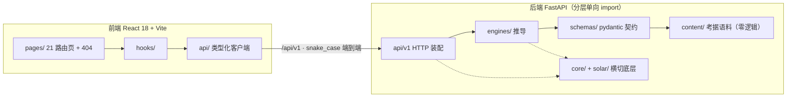

# Destiny · 跨文明命运测算聚合平台

> *「Astral Observatory —— 把四大文明的神秘学，装进同一座严谨的天文台。」*


[](backend/pyproject.toml) [](https://fastapi.tiangolo.com) [](frontend/package.json) [](frontend/package.json) [](docker-compose.yml) [](scripts/verify.sh)

**一座聚合中华古典术数、西方占星、印度吠陀与北欧符文的全息推演平台。**
所有排盘由权威计算库（`lunar-python` 干支节气 / `pyswisseph` DE431 星历）与自建考据语料产出，**绝对禁止 LLM 手搓核心算法，全栈零 mock**。

[快速开始](#快速开始) · [体系矩阵](#体系矩阵) · [架构](#架构) · [工程铁律](#工程铁律) · [API 与错误契约](#api-与错误契约) · [测试](#测试) · [目录结构](#目录结构)

---

## 它是什么

泛兴趣用户输入生辰、报数或一次抽牌，得到一份**有出处、可复算**的推演结果：

| 普通测算站的痛点 | Destiny 的做法 |
|---|---|
| 排盘算法靠程序员手搓星表，错了没人知道 | 历法/星历一律取权威库：干支节气用 `lunar-python`，行星位置用 `pyswisseph`（DE431） |
| 全国都按东经 120° 北京时间算 | 真实经纬度城市库（`backend/data/cities.json`），逐人生**真太阳时** |
| 结果是一大段没有依据的模板话 | 响应带 `provenance.tables` 出处清单——端点实际读了哪几张语料表就列哪几张，宁缺勿多 |
| 抽牌结果用 `random` 生成，可预测 | 抽牌/起卦引擎只用密码学安全随机源 `secrets.SystemRandom` |
| 前端拿到假数据开发，上线全走形 | 前端测试夹具全部由脚本打真实后端录制（`scripts/record_frontend_fixtures.py`），零 mock |
| 界面花哨但口径混乱 | 统一设计系统 `Celestial Obsidian`（曜石暗金），全站 App Shell 同一导航与状态栏 |

**测算大厅（首页）** —— 顶部双文明圈导航 + 实时真太阳时授时卡 + 16 格体系聚合矩阵（15 个已上线）：


## 快速开始

**方式一：Docker（一条命令起全站）**

```bash
docker compose up --build
```

| 入口 | 地址 |
|---|---|
| Web 应用（nginx，`/api` 反代到后端） | <http://localhost:8080> |
| 后端 API 直连 / Swagger 文档 | <http://localhost:8000/api/v1> · <http://localhost:8000/docs> |

**方式二：本地开发**

```bash
# 后端（Python ≥ 3.12）
cd backend
python -m venv .venv && source .venv/Scripts/activate   # Windows Git Bash
pip install -e ".[dev]"
python -m app.run            # uvicorn 起在 :8000

# 前端（另开终端）
cd frontend
npm install
npm run dev                  # Vite 起在 :5173，CORS 已放行该来源
```

## 架构

前后端分离，后端内部按依赖单向分层（`backend/tests/test_architecture.py` 机器强制）：



- **content/** — 66 个自建语料模块（纳音、神煞、卦爻辞、奇门局、塔罗牌义、卢恩词表…），纯表、零业务逻辑
- **engines/** — 28 个推导引擎；被禁的反向 import 六对全部为零，是硬门不是基线
- **solar/** — 真太阳时与地理计算，任何层可引
- **frontend/** — 页面不直连 HTTP，接线唯一去处是 `hooks/`；类型照后端 snake_case 响应直通声明，不重命名

## 体系矩阵

测算大厅共 16 个体系条目，其中 15 个已上线；下表按体系聚合（八字五页并作一行，行运/合盘、卡巴拉/数字学各占一行），并列入 1 个 Phase-2 路线图。

| 文明圈 | 系统 | API 组 | 前端路由 | 权威数据源 |
|---|---|---|---|---|
| 中华 | 八字（natal / 流日 / 流时 / 大运 / 合婚） | `bazi` | `/bazi-natal` `/bazi-liuri` `/bazi-liushi` `/bazi-transit` `/bazi-hehun` | lunar-python + 自建规则表 |
| 中华 | 紫微斗数 | `ziwei` | `/ziwei-doushu` | lunar-python 安星输入 |
| 中华 | 奇门遁甲 | `qimen` | `/qimen-dunjia` | 自建局表 |
| 中华 | 周易六爻 | `zhouyi` | `/zhouyi-divination` | 卦爻辞语料 + `secrets` 起卦 |
| 中华 | 梅花易数 | `meihua` | `/plum-blossom` | 报数起卦，确定性无随机 |
| 中华 | 姓名学 | `name` | `/name-metric` | 三才五格 + 康熙字典笔画表 |
| 中华 | 麻衣面相神鉴（Phase-2） | — | — | CV 模型校准，尚未排盘 |
| 西洋 | 本命占星 | `western` | `/western-astrology` | pyswisseph DE431 |
| 西洋 | 行运 / 合盘 | `transit` `synastry` | `/astrology-transit` `/astrology-synastry` | pyswisseph |
| 西洋 | 塔罗 | `tarot` | `/tarot-oracle` | 78 张牌义语料 + `secrets` |
| 西洋 | 雷诺曼 | `lenormand` | `/lenormand-cards` | 36 张牌义语料 + `secrets` |
| 西洋 | 卡巴拉 / 数字学 | `kabbalah` `numerology` | `/kabbalah-tree` `/numerology-matrix` | 毕达哥拉斯/洛书语料 + Gematria 表 |
| 印度 | 吠陀占星 | `vedic` | `/vedic-astrology` | pyswisseph（恒星黄道） |
| 北欧 | 卢恩符文 | `runes` | `/norse-runes` | Elder Futhark 词表 + `secrets` |

### 实拍图廊

以下均为本地真实运行的计算结果（示例生辰见各页头注），非设计稿：

<table>
  <tr>
    <td width="50%"><b>四柱八字精算排盘</b><br>真太阳时校正 → 干支/十神/藏干/纳音 → 身强身弱得分 → 用神三层 → 大运时间轴 → 命格/格局/运势详批 → 数据溯源账本<br></td>
    <td width="50%"><b>本命星盘与时空推运</b><br>pyswisseph 天球黄道命盘轮图（Placidus 分宫）→ 本命三巨头 → 十大主星与交点历表 → 元素/形态分布 → 关键相位网格<br></td>
  </tr>
</table>

## 工程铁律

六条全部有机器检查或代码证据（详见 [AGENTS.md](AGENTS.md)）：

| 铁律 | 落点 |
|---|---|
| **禁 LLM 手搓排盘**：干支/节气/行星位置只取权威库，引擎不自算历法 | `pyproject.toml` 依赖 + PRD §10.2 |
| **抽签类只准 `secrets`**：tarot/lenormand/runes/zhouyi 禁 `import random` | `test_architecture.py::test_draw_engines_use_csprng` |
| **零 mock**：生产代码与测试都不引假数据，前端夹具唯一来源是打真实 `:8000` 录制 | `scripts/record_frontend_fixtures.py` |
| **出处诚实**：`provenance.tables` 只列端点真读过的表，按系统分开维护 | `app/content/__init__.py` |
| **分层单向 import**：content → schemas → engines → api，六对反向全禁且实测为零 | `backend/tests/test_architecture.py` |
| **snake_case 端到端**：响应不重命名，前端类型照响应形状直通 | `frontend/src/api/client.ts` |

## API 与错误契约

所有端点在 `/api/v1` 下；字段自身的校验（长度/枚举/边界）归 pydantic，走 FastAPI 默认 422；**字段之间**的关系性错误由引擎抛 `DestinyError` 子类，返回统一信封（状态码按子类分：5×422 / 2×400 / 1×500）：

```json
{ "error": { "code": "transit_range_out_of_bounds", "message": "……给人看的文案", "context": { } } }
```

前端**不按文案渲染、不按状态码分支**，一律消费 `error.code`。示例：

```bash
curl -s http://localhost:8000/api/v1/numerology/chart \
  -H 'Content-Type: application/json' \
  -d '{"full_name":"Ada Lovelace","birth_date":"1815-12-10"}'
```

完整交互式文档在 <http://localhost:8000/docs>（FastAPI OpenAPI）。

## 测试

唯一全栈门禁是 `scripts/verify.sh`：后端 pytest → 前端 typecheck → vitest → build，再跑测试清单对账与夹具漂移检查，一次跑齐。

```bash
bash scripts/verify.sh
```

| 层 | 手段 | 规模（2026-10-23 实测） |
|---|---|---|
| 后端 | pytest（golden 直调 `compute_*` + `TestClient` 真实响应） | 96 个测试文件 / 16,644 用例全绿 |
| 前端 | vitest + Testing Library，架构不变式单独一套 | 50 个测试文件 / 223 用例全绿 |
| 架构 | `test_architecture.py` + `conventions.test.ts` 双侧断言，互不重复 | import 方向 / 后端四件齐备 / 随机源 / 账本印刷形状 |

## 目录结构

```
destiny/
├── backend/
│   ├── app/
│   │   ├── content/        66 个考据语料模块（纯表，零逻辑）
│   │   ├── schemas/        pydantic 请求/响应契约
│   │   ├── engines/        28 个推导引擎
│   │   ├── api/v1/         15 个系统路由 + meta 平台路由
│   │   ├── core/           config / errors / provenance（横切）
│   │   └── solar/          真太阳时与地理（横切）
│   ├── data/cities.json    真实经纬度城市库
│   └── tests/              pytest + golden + 架构门
├── frontend/
│   ├── src/
│   │   ├── pages/          21 个路由页 + 404（App Shell 统一导航）
│   │   ├── components/     按系统分目录 + ui 共享件
│   │   ├── hooks/  api/  types/   接线层 / 类型化客户端 / snake_case 直通类型
│   │   └── lib/            文案印刷形状集中处（scoring.ts）
│   └── tests/              vitest 测试 + 真实录制夹具
├── design/<系统>/code.html 高保真设计稿（视觉参照，不是契约）
├── prd/                    产品需求文档 v2.0
├── docs/superpowers/       各功能的 findings / plans / specs 过程记录
├── scripts/                verify.sh 全栈门禁 + 前端夹具录制
└── docker-compose.yml      backend :8000 + frontend(nginx) :8080
```

## 免责声明

本平台内容基于古代典籍与现代数理模型的自动推导，仅供文化研究、学术探讨与娱乐参考，不构成任何现实决策建议。命由己造，相由心生。

---

*星辰不问赶路人，但会如实记录每个人的出生时刻。*
